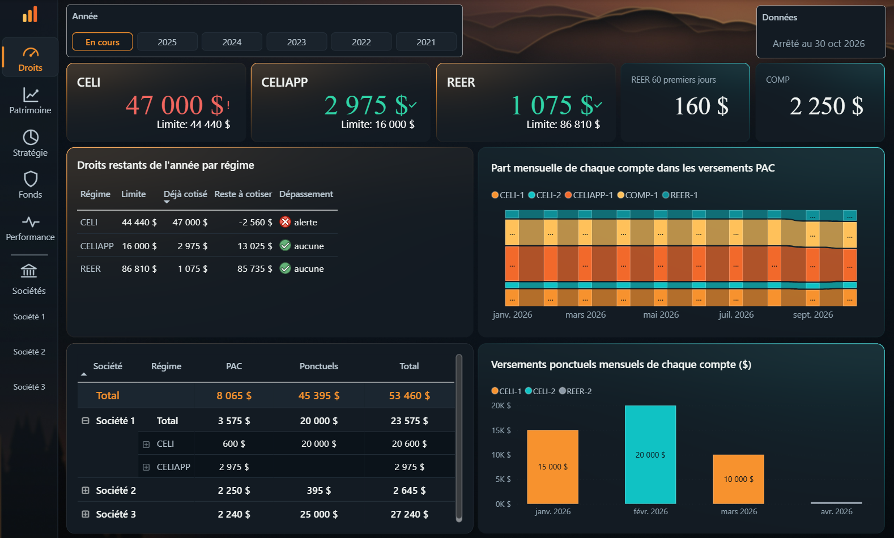
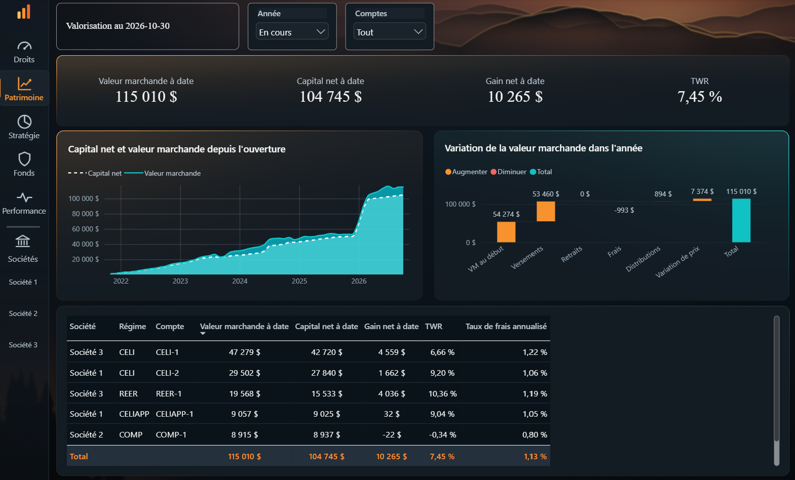
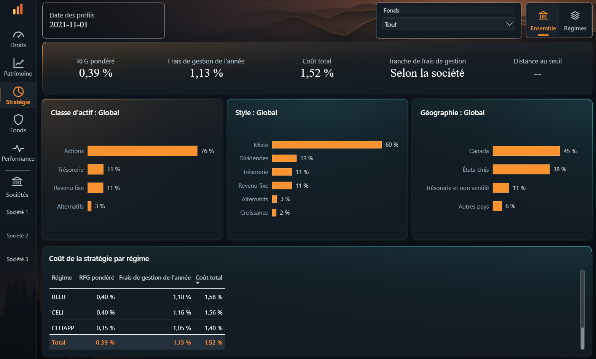
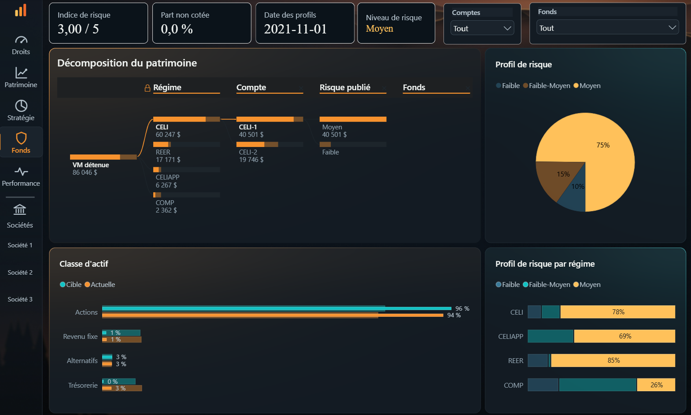
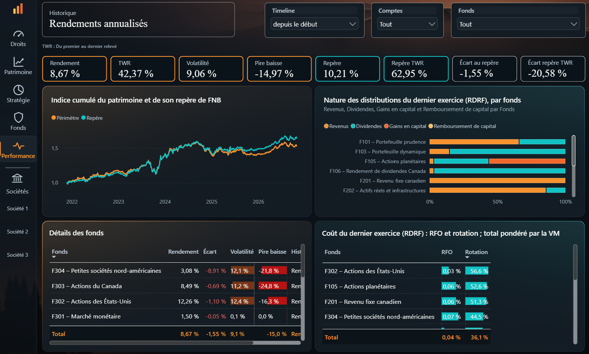
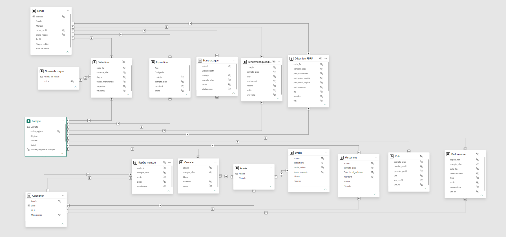

<p align="center">
  
</p>

# Épargne enregistrée — tableau de bord Power BI
## CELI · CELIAPP · REER · comptes non enregistrés, sur données entièrement fictives


### → [sebastienoger.ca/projets/investment-insights](https://sebastienoger.ca/projets/investment-insights)

Le rapport publié, en ligne : cinq pages interactives sur le jeu fictif. Rien à installer, aucun
identifiant — ouvrir et cliquer.

---

Un épargnant détient des comptes CELI, CELIAPP, REER et non enregistrés chez **trois sociétés de
fonds**, chacune avec son conseiller. Aucun conseiller ne voit ce que font les autres : deux d'entre
eux peuvent remplir le même plafond sans le savoir, ou bâtir la même stratégie dans deux régimes.
Ce tableau de bord remet les trois vues bout à bout.

> **Toutes les données sont fictives, cours compris.** Sociétés, comptes, fonds, valeurs liquidatives,
> repères, versements et avis REER sortent d'un générateur à graine fixe, publié dans ce dépôt
> ([`Generateur-data-fictive/`](Generateur-data-fictive/)). Aucun fonds, FNB ni indice réel ne sert
> de gabarit. Le rapport s'ouvre sans base de données : chaque table est embarquée dans le modèle.

Auteur : Sébastien Oger.

---

## En bref

| | |
|---|---|
| Questions traitées | **4** — droits restants, répartition des versements, performance contre repère, recouvrement des stratégies |
| Rapport | **5 pages** : Droits, Patrimoine, Stratégie, Fonds, Performance |
| Modèle sémantique | **21 tables**, **22 relations**, **66 mesures** DAX regroupées dans une table Mesures |
| Calcul | **45 vues SQL** (`sql/vues.sql`) : les règles vivent en SQL, le DAX se réduit à des sommes et au chaînage |
| Jeu fictif | **3 sociétés**, **6 comptes**, **14 fonds**, **1 935 transactions**, **55 749 cours quotidiens**, de novembre 2021 à octobre 2026 |
| Règles de droits | **15 règles documentées** (R1 à R15), chaque règle fiscale citée avec sa page canada.ca |
| Générateur | **7 jalons contractualisés**, rejouable à l'identique octet pour octet, **261 tests** pytest, tous verts |
| Contrôle avant publication | balayage de fuite sur le code, les documents et les partitions figées du modèle |

---

## Les quatre questions

1. Combien reste-t-il de **droits CELI, CELIAPP et REER** pour l'année, et qui y verse quoi ?
2. Quelle part des versements mensuels va dans chaque compte, **PAC et ponctuels distingués** ?
3. Quel compte **performe ou sous-performe** par rapport à son repère ?
4. Les stratégies des sociétés **se recouvrent-elles** : mêmes classes d'actif, mêmes styles, dans des
   comptes différents ?

---

## Le rapport

**[→ sebastienoger.ca/projets/investment-insights](https://sebastienoger.ca/projets/investment-insights)** —
les captures ci-dessous en sont des images fixes ; segments, info-bulles et navigation ne
fonctionnent que dans la version en ligne. Captures prises sur le jeu fictif, arrêté au 30 octobre 2026.

### Droits — combien reste-t-il à cotiser, et qui verse quoi


Les droits sont **reconstruits** à partir des versements, des avis de cotisation et des plafonds, puis
recoupés avec l'avis : recopier le chiffre de l'ARC ne contrôlerait rien. Le REER se suit par
**année de déduction**, pas par année civile, d'où la carte des 60 premiers jours. Un dépassement
s'affiche en alerte dès qu'il existe ; le CELI et le CELIAPP sont imposés dès le premier dollar,
le REER garde sa marge tolérée.

### Patrimoine — ce que vaut l'épargne, et pourquoi elle a bougé



Valeur marchande, capital net et gain, compte par compte. Le rendement est un **TWR par la méthode de
Dietz modifiée**, mois par mois puis chaîné ; celui d'un agrégat est le Dietz de l'agrégat, pas une
moyenne de rendements. Le TRI a été écarté : il dépend du calendrier des versements de l'épargnant
et pénaliserait une société pour une décision qui n'est pas la sienne. La cascade décompose la
variation de l'année : versements, retraits, frais, distributions, variation de prix.

### Stratégie — ce que contiennent vraiment les fonds



Une **transparence à un niveau** : chaque fonds est décomposé par classe d'actif, style et géographie,
pondéré par la valeur marchande. C'est cette page qui répond à la question 4 : deux sociétés peuvent
porter les mêmes actions mondiales dans deux comptes différents. Le coût de la stratégie additionne
le RFG pondéré et le taux de frais de gestion du compte ; la tranche de frais se lit **par société**,
au seuil de 100 000 $.

### Fonds — le risque publié et l'écart à la cible



Le niveau de risque est **lu dans les profils publiés, jamais saisi**. L'indice de risque est une
moyenne, pondérée par la valeur marchande, d'une échelle ordinale à cinq niveaux. L'écart tactique
compare la répartition actuelle à la répartition stratégique, classe par classe.

### Performance — contre quel repère



Rendement annualisé, volatilité, pire baisse et écart au repère, par fonds et par compte. Chaque fonds
a un repère composite ; sous 60 rendements quotidiens, la page affiche « historique insuffisant »
plutôt qu'un chiffre. Le rendement quotidien est **avant** frais du compte, le TWR **après** : la page
le dit. Les deux tableaux du bas lisent les rapports annuels de la direction : nature des
distributions, RFO et taux de rotation.

---

## Comment c'est construit

### La chaîne d'exploitation


La version d'exploitation lit des exports de portail, extrait les PDF publics des fonds (profils
mensuels, rapports annuels), récupère les cours, charge le tout dans PostgreSQL derrière des
contrôles bloquants, puis recette chaque famille de vues contre un témoin pandas indépendant.
**Ce pipeline n'est pas publié** : il traite des données réelles. Ce dépôt en décrit la méthode et
l'architecture ; le rapport publié est alimenté par le générateur fictif.

### La chaîne publiée

```
Generateur-data-fictive/  ──►  finance_ve01/*.csv  ──►  PostgreSQL (schéma, plafonds, vues)
        graine fixe                                          │
                                                             ├──►  recette contre l'oracle du générateur
                                                             │
                                                             └──►  scripts/figer.py  ──►  rapport PBIP
                                                                   tables embarquées, aucune base à l'ouverture
```

Les deux chaînes partagent le même cœur : le schéma SQL, les vues `rapport.*` et le modèle Power BI.
Seule la source change.

### Le modèle sémantique



Les tables de faits (détention, exposition, écart tactique, rendement quotidien, versements, droits,
coûts, performance) rayonnent autour de deux dimensions pivots, **Compte** et **Fonds**, et d'un
calendrier. Les mesures sont toutes dans la table Mesures ; les règles de calcul, dans `sql/vues.sql`.

| Brique | Rôle |
|---|---|
| **Python 3.14** | générateur de données fictives ; chargement par `COPY`, recette, gel des partitions |
| **PostgreSQL 18** | schémas `fait`, `ref`, `pub`, `rapport` ; plafonds fiscaux sourcés ; 45 vues de calcul |
| **Power BI Desktop** | rapport PBIP de 5 pages, modèle TMDL en mode Import, 66 mesures DAX |
| **Claude Code** | agent de développement, piloté par contrats de jalon et vérifié par un évaluateur indépendant |

---

## Des données fictives qui tiennent debout

**Pourquoi un générateur plutôt qu'un masquage.** Masquer des noms et des montants garde la structure :
dates d'ouverture, rythmes de versement, répartition entre sociétés. Une structure suffit à reconnaître
une personne. Un jeu publiable doit donc être **produit, pas maquillé**.

**Pourquoi le désordre ne s'écrit pas à la main.** Un premier jeu, écrit à partir de listes, a été
rejeté : trop régulier, trop propre. Un modèle de langage produit spontanément des montants ronds, des
calendriers symétriques, des progressions lisses. Le générateur écrit donc des **paramètres de
stratégie** par société, puis tire les événements de distributions à graine fixe ; rien n'est écrit à
la main au niveau des versements.

Chaque société a une signature lisible dans le rapport, et deux d'entre elles se recouvrent
volontairement : la question 4 doit avoir quelque chose à montrer.

---

## La méthode

- **Une itération, un contrat.** Chaque jalon pose ses critères d'acceptation avant le travail ; un
  évaluateur indépendant les vérifie après, critère par critère, preuve à l'appui. Les contrats et
  leurs preuves sont publiés dans [`jalons/`](jalons/).
- **Recette contre un calcul indépendant.** Les vues `rapport.*` sont comparées à l'oracle du
  générateur, qui calcule les mêmes grandeurs sans SQL.
- **Une règle fiscale non sourcée est une erreur différée.** Chaque plafond de `sql/plafonds.sql`
  porte sa page canada.ca.
- **La confidentialité se conçoit.** Avant chaque publication, un balayage cherche les motifs sensibles
  dans le code, les documents, les données et les partitions figées du modèle, décompressées avant la
  recherche. Les motifs sont lus hors du dépôt ; la sortie n'imprime que des nombres d'occurrences.

Pour aller plus loin :

- [Histoire du projet](docs/histoire-du-projet.md) : les itérations, les décisions, ce qui a été écarté
  et pourquoi ;
- [Architecture](docs/architecture.md) : les deux chaînes, schéma par schéma ;
- règles de calcul citées par `sql/vues.sql` : [droits](docs/regles-droits.md),
  [performance](docs/regles-performance.md), [stratégie](docs/regles-strategie.md).

---

## Ouvrir le rapport

Le plus simple : la [version en ligne](https://sebastienoger.ca/projets/investment-insights).
En local, ouvrir `rapport/DashBoard-Finance.pbip` dans Power BI Desktop, puis **Actualiser**. Aucune base, aucun
identifiant : les tables sont embarquées dans le modèle.

### Reconstruire de zéro (facultatif)

Avec PostgreSQL local et une base `finance_ve01` :

```bash
# 1. Générer le jeu fictif (depuis Generateur-data-fictive/)
python -m synthetic_finance generate --config configs/vitrine.toml --seed 20261103 \
       --out outputs/vitrine_seed_20261103 --stage adapter

# 2. Charger : rejoue schema.sql, plafonds.sql, vues.sql, puis COPY
python scripts/charger_synthetique.py --path Generateur-data-fictive/outputs/vitrine_seed_20261103

# 3. Recetter les vues contre l'oracle du générateur
python scripts/recette_synthetique.py --controle distributions|grand-livre|oracle|rapport

# 4. Figer les partitions dans le modèle, Power BI Desktop fermé
python scripts/figer.py
```

---

## Organisation du dépôt

```
rapport/                  rapport PBIP : définition PBIR des pages, modèle sémantique TMDL
sql/                      schéma, plafonds fiscaux sourcés, vues de calcul rapport.*
scripts/                  chargement, recette, gel des partitions
Generateur-data-fictive/  générateur à graine fixe, ses tests, ses sorties et son contrat de données
docs/                     histoire du projet, architecture, règles de calcul
jalons/                   contrats de jalon et preuves de l'évaluateur
Asset/                    captures du rapport et schémas
```

---

## Limites connues

- Le pipeline d'ingestion des données réelles n'est pas publié ; seule sa méthode l'est.
- Les plafonds et règles fiscales sont ceux de l'Agence du revenu du Canada à la date de construction ;
  ils ne se mettent pas à jour seuls.
- Le rapport est figé : pour changer de données, il faut rejouer la chaîne de reconstruction.
