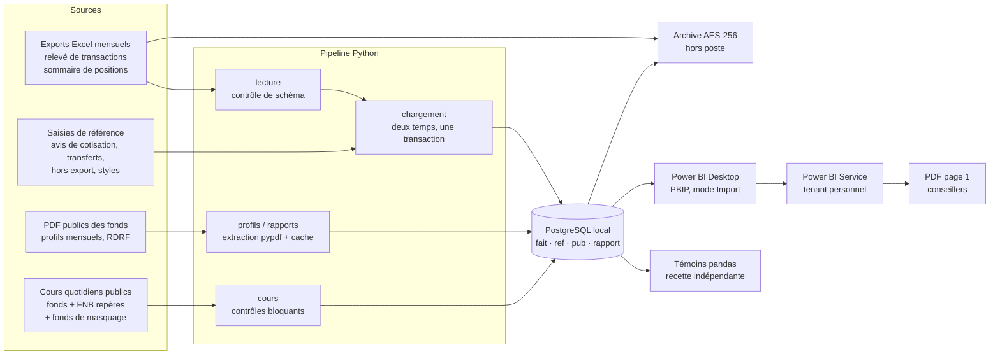
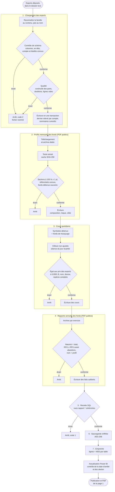
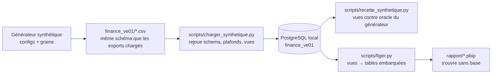

# Architecture — chaîne d'exploitation et chaîne publiée

Deux chaînes partagent le même cœur : le schéma SQL, les vues `rapport.*` et le modèle Power BI. Elles
diffèrent par la source des données : des exports de portail pour la chaîne d'exploitation, le
générateur fictif pour ce dépôt. Le récit des étapes est dans [histoire-du-projet.md](histoire-du-projet.md).
Toutes les données de ce dépôt sont fictives.

## Chaîne d'exploitation (non publiée)

Le pipeline d'ingestion de la version d'exploitation (lecture des exports, extraction de PDF
publics, cours, chargement PostgreSQL) existe, mais **n'est pas présenté ici, pour des raisons de
confidentialité** : il traite des données réelles. Ce dépôt en décrit la méthode, les outils et
l'architecture ; le rapport publié est alimenté par le générateur fictif.

**Routine mensuelle**, un seul script qui s'arrête à la première étape en échec et nomme le fichier en
cause : chargement → profils → cours → rapports → recette SQL → sauvegarde → empreinte. Puis, à la
main : actualiser dans Desktop, contrôler la date d'arrêté et les alertes, publier, exporter le PDF de
la page 1, l'envoyer. Cible : 10 minutes de travail manuel.

### Détail du pipeline : étapes et contrôles

Chaque étape lit et contrôle tout **avant** d'ouvrir la base ; l'écriture se fait en une seule
transaction. Le premier contrôle en échec arrête la routine : rien n'est écrit, rien n'est publié.

Hors routine, à chaque jalon : les témoins pandas recalculent chaque vue sans SQL et doivent donner le
même chiffre (écart nul en cents pour les droits).

**Modules du pipeline d'exploitation** (décrits, non publiés : confidentialité).

| Module | Rôle |
|---|---|
| `lecture` | Un lecteur par famille d'export, reconnue au nom de la feuille ; toute surprise de format lève un écart de schéma. N'écrit rien |
| `chargement` | Tout lire et tout contrôler, puis tout écrire dans une transaction ; code de sortie 2 si un écart arrête le chargement |
| `empreinte` | Nombre de lignes et MD5 par table : preuve d'idempotence |
| `fictifs` | Classeurs fictifs (valide + fautif) pour éprouver le contrôle de schéma |
| `profils` | Téléchargement, archive et extraction des profils mensuels ; contrôles de somme à 100 % |
| `rapports` | Idem pour les RDRF ; contrôles S14 |
| `pdf` | Texte extrait une fois, mis en cache par SHA-256 et version de pypdf |
| `cours` | Cours quotidiens publics ; seule la clôture non ajustée des fonds est lue ; fonds de masquage |
| `controle_droits`, `controle_performance`, `controle_strategie`, `controle_risque`, `controle_distributions` | Témoins pandas : chaque vue recalculée sans SQL |
| `recette` | Requêtes de recette SQL ; code de sortie 1 au moindre écart |
| `sauvegarde` | Dump de la base et exports dans une archive 7-Zip AES-256, liste des fichiers chiffrée |
| `preuves` | Sorties des jalons, sans montant ni numéro de compte |

## Outils

| Couche | Outils |
|---|---|
| Ingestion | Python 3.14 ; pandas 3 ; openpyxl (classeurs d'export) ; pypdf (texte des PDF publics) ; téléchargements HTTP par la bibliothèque standard |
| Stockage | PostgreSQL 18 local ; psycopg 3 ; schémas `fait`, `ref`, `pub`, `rapport` ; règles de calcul en vues SQL |
| Recette | Témoins pandas indépendants ; requêtes de recette SQL ; empreinte MD5 par table |
| Orchestration | Script PowerShell de routine mensuelle : étapes en série, arrêt au premier échec |
| Sauvegarde | Archive 7-Zip AES-256, liste des fichiers chiffrée |
| Rapport | Power BI Desktop au format PBIP (TMDL pour le modèle, PBIR pour les pages) ; DAX ; Power Query M ; mode Import ; Power BI Service (licence Pro) |
| Développement | git local ; Claude Code : contrats de jalon, sous-agent évaluateur en lecture seule, serveur MCP de modélisation Power BI pour les requêtes DAX de recette |
| Données fictives (publiées) | Générateur Python à graine fixe (numpy) ; pytest et Hypothesis |

## Chaîne publiée (ce dépôt, données fictives)

Ce qui change par rapport à la chaîne d'exploitation :

| Élément | Exploitation | vE01 |
|---|---|---|
| Transactions, sommaires | Exports Excel lus par `lecture` | CSV de l'adaptateur du générateur |
| Profils, RDRF | PDF publics archivés et extraits | Tables `pub.*` synthétiques |
| Cours, repères | Cours publics quotidiens, FNB de substitution | Valeurs liquidatives et repères synthétiques (`SYN-…`) |
| Recette | Témoins pandas contre les vues | Vues contre l'oracle du générateur |
| Ouverture du rapport | Base locale, mode Import | Tables figées dans le modèle |
| Sécurité d'écriture | Base dédiée | Tout script qui écrit vérifie `current_database() = 'finance_ve01'` |

Ce qui ne change pas : `sql/schema.sql`, `sql/plafonds.sql`, `sql/vues.sql`, le modèle sémantique et ses
mesures, les pages du rapport.
